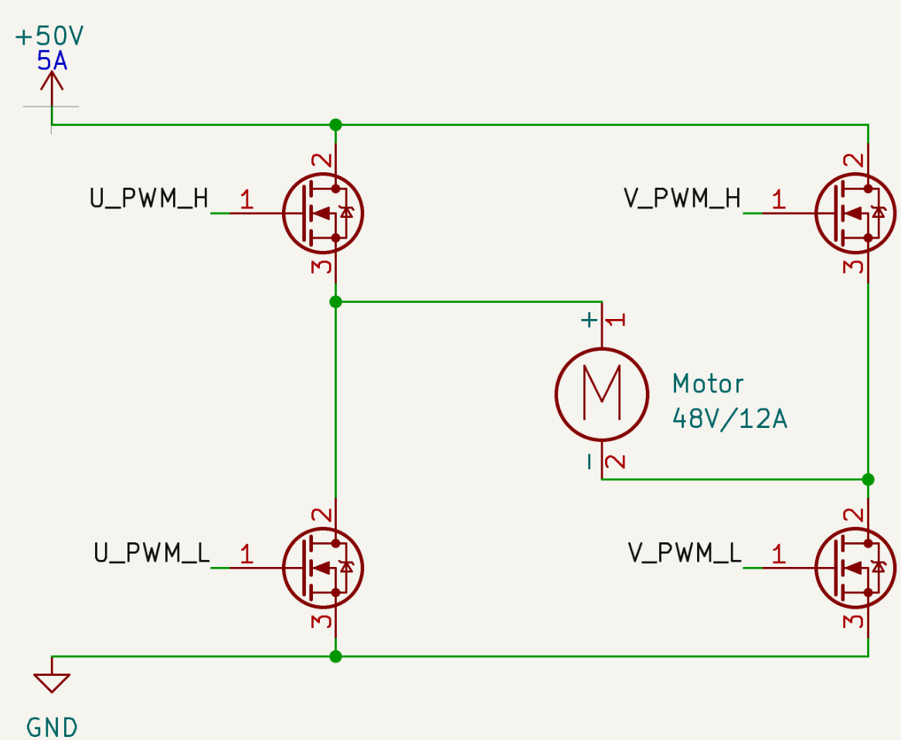
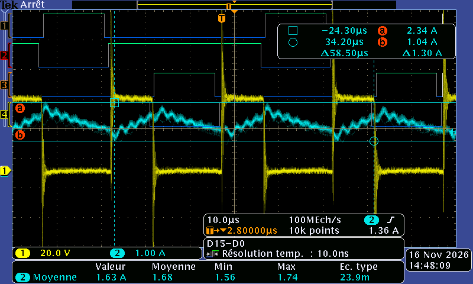

# TP AAA — Commande d'un moteur par hacheur en pont H

Compte rendu de Salim BOUATELI et Yehia ZEAITER, organisé suivant les parties de
l'[énoncé du TP](<TP/Sujet Travaux pratiques _ MOODLE ENSEA.pdf>).

## 1 — Objectifs et matériel

Le projet utilise une Nucleo-STM32G474RE et un hacheur pour commander une
machine à courant continu (MCC). Les objectifs sont la génération des
quatre commandes de transistors, l'acquisition des capteurs, puis
l'asservissement en temps réel.

Nous avons réalisé la commande en boucle ouverte, la mesure du courant
moteur d'abord en polling puis par Timer/ADC/DMA synchronisé avec les PWM,
et la mesure de vitesse par codeur. L'asservissement en boucle fermée
reste à réaliser.

## 2 à 4 — Organisation du travail et du projet

Nous avons conservé le projet STM32CubeIDE dans `TP/software/Base/` et
séparé le code applicatif en trois domaines : commande moteur, acquisition
et interface utilisateur. L'application orchestre les commandes et la rampe
moteur dans la boucle principale. La réception UART est gérée par
interruption. Après une première acquisition analogique en polling avec
une attente bornée, nous avons mis en place un déclenchement matériel par
TIM1 et un transfert DMA.

## 5 — Interface de commande UART

Nous avons intégré un shell sur la liaison série USB, configurée à
**115200 bauds, 8 bits de données, sans parité et avec 1 bit de stop**.
Cette interface nous a permis d'envoyer les consignes du moteur et de
relever les mesures de courant depuis le terminal.

La saisie est limitée aux lettres non accentuées, chiffres, espaces, `_`
et `=`, avec un maximum de 63 caractères. La correction par Backspace et
les fins de ligne CR, LF et CRLF sont prises en charge. Une ligne trop
longue ou contenant un caractère refusé est rejetée à la validation par
Entrée avec le message `Invalid or too long command`. Après un caractère
refusé, le reste de la ligne est ignoré jusqu'à Entrée. Les caractères tels
que `-` et `ç` ne sont donc pas acceptés.

## 6 — Commande MCC basique

Le moteur est raccordé entre les points milieux des bras U et V. Chaque
bras comporte un transistor haut et un transistor bas commandés en
complémentaire, avec un temps mort entre leurs activations.



*Schéma fourni : alimentation indiquée à 50 V / 5 A et moteur indiqué à
48 V / 12 A. Les drivers de grille ne sont pas représentés sur ce dessin
de principe.*

### 6.1 — Génération des quatre PWM

#### Configuration réalisée

| Commande | Broche Nucleo | Sortie du timer |
| --- | --- | --- |
| `U_PWM_H` | PA8 | TIM1_CH1 |
| `U_PWM_L` | PB13 | TIM1_CH1N |
| `V_PWM_H` | PA9 | TIM1_CH2 |
| `V_PWM_L` | PB14 | TIM1_CH2N |

Le bras W n'est pas utilisé pour ce moteur. Nous avons configuré deux paires complémentaires de TIM1, en PWM centrée, avec des
rapports cycliques complémentaires entre U et V.

| Grandeur | Exigence de l'énoncé | Configuration retenue |
| --- | --- | --- |
| Fréquence PWM | 20 kHz | 20 kHz calculés |
| Résolution | Au moins 10 bits | Environ 12 bits |
| Temps mort | À dimensionner et faire valider | 1 µs programmé, validation de puissance à compléter |
| Point de test | 60 % | CCR1 = 2550 et CCR2 = 1700 |

#### Horloge, période et résolution

L'horloge configurée est issue du quartz de 24 MHz et de la PLL :

$$
f_{TIM1} = \frac{24\,\mathrm{MHz}}{6}\times\frac{85}{2}
= 170\,\mathrm{MHz}
$$

Le compteur est en mode center-aligned, avec un prescaler de 0. Un cycle
complet correspond à une montée puis une descente du compteur :

$$
f_{PWM} = \frac{f_{TIM1}}{2(PSC+1)ARR}
= \frac{170\times10^6}{2\times4250}
= 20\,\mathrm{kHz}
$$

La période est donc de 50 µs. Le réglage de comparaison offre environ
4250 pas sur la plage de rapport cyclique, soit :

$$
R \simeq \log_2(4250) \simeq 12{,}05\,\mathrm{bits}
$$

La résolution minimale de 10 bits est ainsi dépassée. Pour le point de
test à 60 %, CCR1 vaut 0,6 × 4250 = 2550 et CCR2 vaut 1700. Les rapports
cycliques nominaux sont de 60 % sur U et 40 % sur V, avant l'effet du temps mort.

#### Temps mort et vérification des signaux

Les transistors du schéma KiCad sont des IRF540N, commandés par des
HCPL-315J avec des résistances de grille de 30 Ω.
La [datasheet IRF540N](https://www.infineon.com/assets/row/public/documents/24/49/infineon-irf540n-datasheet-en.pdf)
donne des délais typiques de 11 ns à l'allumage, 39 ns à l'extinction et
35 ns de temps de descente, pour une résistance de grille de 5,1 Ω et une
commande de grille de 10 V. Le
[HCPL-315J](https://docs.broadcom.com/doc/AV02-0164EN)
spécifie un écart de propagation entre commandes pouvant atteindre 350 ns
dans ses conditions de caractérisation.

Les délais du MOSFET sont des valeurs typiques mesurées dans des
conditions différentes de celles de notre montage. Nous avons réglé le
temps mort à **1 µs**. Il reste à vérifier ce réglage sur les quatre signaux.

Avec une division d'horloge de 1, le pas de base vaut 1 / 170 MHz. Le code
de temps mort DTG = 149 = 0x95 donne :

$$
t_{mort} = (64+21)\times2\times\frac{1}{170\times10^6}
= 1\,\mu\mathrm{s}
$$


*La capture disponible affiche un écart entre fronts de 1,008 µs, proche
du réglage de 1 µs. L'identification des voies et des bras observés n'a pas été consignée.
Cette capture ne caractérise donc pas à elle seule l'extinction réelle
des MOSFET ni l'ensemble des quatre signaux.*

### 6.2 — Commande du rapport cyclique par UART

Nous avons ajouté la commande `SET_CCR XXXX` pour modifier le rapport
cyclique depuis le terminal. L'argument est interprété comme un entier
décimal et seules les valeurs composées de chiffres sont acceptées. La plage autorisée est **0 à 4250 inclus** :
`PWM_MAX = ARR = 4250`. La valeur X correspond à un rapport cyclique
X / PWM_MAX sur le bras U.

Après validation, la valeur X est appliquée aux deux canaux :

- `CCR1 = X` pour le bras U ;
- `CCR2 = ARR − X` pour le bras V.

Les sorties complémentaires CH1N et CH2N suivent les canaux principaux avec
le temps mort configuré dans TIM1. Ces commandes agissent sur le rapport
cyclique ; elles ne constituent pas à elles seules un asservissement de
vitesse.

Par exemple, `SET_CCR 2550` applique CCR1 = 2550 et CCR2 = 1700. Le shell
confirme les valeurs par le message :

```bash
CCR1=2550 CCR2=1700 MAX=4250
```

L'énoncé demande de plafonner la consigne à 4250. Notre code affiche une
erreur et garde la consigne précédente.

#### Gestion des saisies incorrectes

Si une rampe est déjà active lors du rejet, elle continue vers sa cible
précédente.

Les messages distinguent une valeur hors plage, un argument non numérique
et un nombre d'arguments incorrect :

| Cas rejeté | Message retourné |
| --- | --- |
| Valeur supérieure à 4250 | `Error: value out of range. CCR range: 0-4250.` |
| Argument contenant des lettres | `Error: enter digits only. CCR range: 0-4250.` |
| Argument absent ou arguments multiples | `Error: enter one digits-only value. CCR range: 0-4250.` |
| Caractère refusé ou ligne trop longue | `Invalid or too long command` |

Avec cette loi de commande, **X = 0 n'est pas une commande d'arrêt** : les
rapports cycliques des bras valent idéalement 0 % et 100 %. Pour X = 2125,
les deux bras ont le même rapport cyclique et la tension moyenne idéale
entre U et V est nulle ; cela ne garantit pas l'arrêt mécanique du moteur.
La commande `stop` désactive les PWM ; elle ne garantit pas non plus un
arrêt mécanique instantané.

### 6.3 — Premiers tests

#### Points de fonctionnement étudiés

Avec la modulation retenue, le rapport cyclique indiqué est celui du bras U.
Celui du bras V est complémentaire : pour une consigne de 70 % sur U, il vaut
30 % sur V. Avec ARR = 4250, les valeurs correspondantes sont :

| Point de fonctionnement | CCR1 | CCR2 | Rapport cyclique U | Rapport cyclique V | Tension moyenne idéale entre U et V |
| --- | --- | --- | --- | --- | --- |
| Consigne de 50 % | 2125 | 2125 | 50 % | 50 % | 0 |
| Premier démarrage observé | 2400 | 1850 | 56,47 % | 43,53 % | 0,1294 × Vbus |
| Consigne de 70 % | 2975 | 1275 | 70 % | 30 % | 0,4 × Vbus |

Ces tensions sont calculées à partir du modèle idéal du pont, sans tenir
compte des temps morts ni des chutes de tension des composants :

$$
\overline{V_{UV}} = (D_U - D_V)\,V_{bus}
= \left(\frac{2\,CCR1}{4250}-1\right)V_{bus}
$$

Les valeurs à 70 % décrivent la consigne calculée ; aucun relevé de vitesse
ou de courant n'est rapporté ici pour ce point. Le schéma de principe
indique 50 V / 5 A pour l'alimentation et 48 V / 12 A pour le moteur. La tension réelle du bus et les conditions de charge n'ont pas été
consignées pour ces essais. Les valeurs portées sur le dessin sont des
indications du schéma, et non des mesures effectuées sur le montage.

#### Observations et interprétation du démarrage

À 50 % sur les deux bras, le moteur ne tourne pas. Ce résultat est cohérent
avec une tension moyenne idéale nulle à ses bornes.

En augmentant progressivement CCR1 par pas de 100 lors de l'essai manuel,
le premier démarrage a été observé pour **CCR1 = 2400**. Cette valeur
correspond à CCR2 = 1850 et à une tension moyenne idéale d'environ
12,94 % de la tension du bus.

Ce démarrage est compatible avec la nécessité de produire un
couple suffisant pour vaincre les frottements statiques et la charge
mécanique. CCR1 = 2400 est le premier point de démarrage observé avec le pas
d'essai utilisé ; il ne représente pas une mesure précise du seuil minimal.

#### Problème lié aux changements brusques de consigne

Une augmentation brusque du rapport cyclique du bras U, accompagnée de la
diminution de celui du bras V, augmente rapidement la tension moyenne
appliquée au moteur. La vitesse et la force contre-électromotrice ne
pouvant pas augmenter instantanément, cette variation peut entraîner un
appel de courant important. L'inductance du moteur
limite la vitesse de variation du courant : celui-ci ne change pas
instantanément.

*Les pics de courant n'ont pas été mesurés pendant cet essai.*

La rampe automatique ajoutée pour atténuer les changements brusques de
consigne est décrite en partie 7.1.

## 7 — Commande en boucle ouverte et acquisition des mesures

### 7.1 — Commandes moteur et rampe de rapport cyclique

Au démarrage du programme, **les quatre sorties PWM restent désactivées**.
Nous avons ajouté les commandes suivantes :

| Commande | Comportement |
| --- | --- |
| `start` | Fixe les deux bras à 50 % et active les quatre sorties PWM. |
| `stop` | Désactive les quatre sorties PWM et annule la rampe en cours. |
| `speed XXXX` | Rejoint progressivement la cible entre 0 et 4250 sur 3 secondes. Les PWM doivent avoir été activées par `start`. |
| `SET_CCR XXXX` | Réglage direct, sans rampe ; annule une rampe en cours et n'active pas les PWM. |

Le terme `speed` désigne ici une consigne de rapport cyclique, et non une
vitesse mesurée ou une régulation en boucle fermée.

#### Rampe réalisée

Nous avons ajouté une rampe linéaire à la commande `speed` pour atténuer
les variations brusques de tension appliquée au moteur. Le rapport
cyclique évolue de la valeur actuelle vers la cible sur **3 secondes**,
avec une mise à jour toutes les **10 ms**. Les deux bras conservent la
relation CCR2 = ARR − CCR1.

Une évolution de CCR1 = 2125 à CCR1 = 2975 représente ainsi 850 pas
répartis sur 300 intervalles, soit une variation moyenne de 2,83 pas par
intervalle. La progression fonctionne dans les deux sens. Une nouvelle
consigne reçue pendant la rampe repart de la valeur déjà atteinte, sur
une nouvelle durée de 3 secondes.

Le traitement de la rampe laisse le shell disponible. La commande `stop`
annule immédiatement la rampe et désactive les PWM ; **l'arrêt n'est pas
progressif**. La commande `start` rétablit les deux rapports cycliques à
50 %. Une commande `speed` reçue lorsque les PWM sont désactivées est
refusée avec `Error: PWM stopped. Use start first.`

Cette rampe agit sur la consigne en boucle ouverte. La réduction des pics
de courant n'a pas été quantifiée par une comparaison expérimentale avec
et sans rampe.

### 7.2 — Mesure du courant moteur sur le bras U

#### Courant mesuré et capteur retenu

Nous avons mesuré le courant d'induit du moteur sur la sortie du bras U.
Le moteur étant raccordé entre U et V, le courant du bras U correspond au
courant traversant le moteur, avec le signe défini par le sens du capteur.

Le capteur U204 identifié dans le schéma KiCad est un **LEM GO 10-SME/SP3**,
alimenté en 3,3 V. Son signal `U_Imes` est acquis sur **PA1, ADC1_IN2**
de la Nucleo. Cette affectation correspond au projet Nucleo ; elle ne
constitue pas le brochage du STM32 U801 également présent sur le schéma.

#### Fonction de transfert et conversion des mesures

La [datasheet du GO 10-SME/SP3, page 4](https://www.lem.com/sites/default/files/products_datasheets/go_10-20-sme_sp3_series.pdf)
indique une sensibilité nominale de **50 mV/A**, une référence interne
nominale de **1,65 V**, un courant nominal efficace de **10 A** et une
plage de mesure de **−25 à +25 A**. Pour un courant positif allant de IP+
vers IP−, la relation nominale, avec V en volts et I en ampères, est :

$$
V_{sortie} = 1{,}65 + 0{,}050\,I
\qquad\Longleftrightarrow\qquad
I = \frac{V_{sortie}-1{,}65}{0{,}050}
$$

ADC1 est configuré sur **12 bits**, avec un temps d'échantillonnage de
**2,5 cycles**. Les valeurs brutes N sont converties en tension avec une
référence ADC supposée à 3,3 V :

$$
V_{mesuré} \simeq \frac{N}{4095}\times3{,}3
$$

Le courant est ensuite estimé avec le modèle nominal du capteur. Le champ
`I_est` est exprimé en mA. La calibration interne de l'ADC est effectuée
au démarrage ; elle ne remplace pas l'étalonnage du zéro du capteur.
Le zéro réel et la référence ADC n'ont pas encore été mesurés.

#### Première acquisition en polling : PWM désactivées

Dans la première implémentation, chaque commande `current` déclenchait
une acquisition logicielle en polling, avec une attente maximale de
1 ms par conversion. Auto Wait conservait le résultat jusqu'à sa lecture.

Après désactivation des PWM, nous avons obtenu les relevés suivants.
Seules les lignes relatives au courant U sont reproduites ici et dans
les relevés suivants.

```bash
MSC@SAC-TP:/stop
PWM stopped; ramp cancelled.
MSC@SAC-TP:/current
U: ADC=2063 V=1662 mV I_est=249 mA
MSC@SAC-TP:/current
U: ADC=2048 V=1650 mV I_est=8 mA
MSC@SAC-TP:/current
U: ADC=2056 V=1657 mV I_est=136 mA
```

Les tensions calculées sont proches de 1,65 V, valeur nominale de sortie
à courant nul. Le courant estimé varie de **8 à 249 mA**. Ces écarts
peuvent inclure un décalage du zéro et des fluctuations de mesure.
Ils ne permettent pas, à eux seuls, de conclure à un courant résiduel réel :
`stop` désactive les PWM, mais ne confirme pas l'immobilité du moteur ni
un courant effectivement nul au moment des relevés.

#### Acquisition en polling : consigne `speed 3000`

La commande `start` a activé les PWM à 50 %, puis `speed 3000` a demandé
une progression vers CCR1 = 3000 sur 3 secondes. La cible correspond à
CCR2 = 1250, soit environ 70,59 % sur U et 29,41 % sur V.

```bash
MSC@SAC-TP:/start
PWM started: CCR1=2125 CCR2=2125.
MSC@SAC-TP:/speed 3000
Speed target CCR1=3000; ramp=3000 ms.
MSC@SAC-TP:/current
U: ADC=2128 V=1715 mV I_est=1297 mA
MSC@SAC-TP:/current
U: ADC=2185 V=1761 mV I_est=2216 mA
MSC@SAC-TP:/current
U: ADC=2212 V=1783 mV I_est=2651 mA
```

Le courant estimé varie de **1297 à 2651 mA**, soit une étendue de
**1354 mA**. Ces acquisitions n'étaient pas synchronisées avec les PWM :
chaque lecture pouvait correspondre à un point différent de l'ondulation
du courant. Le délai après la consigne et les conditions de charge n'ont
pas été consignés ; le régime stabilisé n'est donc pas garanti pour ces
relevés.

#### Observation du courant moteur à l'oscilloscope

Nous avons également observé le courant du bras U à l'oscilloscope. Sur
la capture ci-dessous, il correspond à la **courbe bleue (voie 2)**,
avec une échelle de **1 A/div** et une base de temps de **10 µs/div**.



Le courant fluctue dans une plage comparable à celle des mesures
numériques. La moyenne affichée sur la capture est de **1,63 A** ; les
curseurs horizontaux sont placés à **1,04 A et 2,34 A**. Ces indications
ne constituent pas une mesure des extrema sur l'ensemble de l'essai.

Nous observons une forme globalement triangulaire, sur laquelle se
superposent des ondulations plus rapides. Cette évolution est cohérente
avec la commande du moteur par le pont H : l'inductance de l'induit
empêche les variations instantanées du courant, dont la pente dépend de
la tension appliquée pendant les différentes phases du découpage.

Cette capture met en évidence une ondulation réelle, compatible avec
une partie de la dispersion des lectures non synchronisées. Elle ne
constitue toutefois pas un étalonnage de la mesure numérique ni une
comparaison au même instant des deux moyens de mesure.

#### Acquisition Timer/ADC/DMA synchronisée avec les PWM

Nous avons remplacé l'acquisition à la demande par un déclenchement
matériel issu de **TIM1, le timer qui génère les PWM**. Le canal interne
CH4, sans sortie sur une broche, fournit la référence OC4REF transmise
à ADC1 par TRGO2. Le DMA transfère les résultats en mémoire, sans attente
de conversion dans la boucle principale.

| Paramètre | Réglage réalisé |
| --- | --- |
| Fréquence de déclenchement | 20 kHz, soit une séquence par période PWM de 50 µs |
| Référence de déclenchement | Front montant de TIM1 OC4REF, via TRGO2 |
| Position programmée | CNT = 3825 pendant la montée, pour ARR = 4250 |
| Avance sur le sommet du compteur | 2,5 µs à 170 MHz |
| Transfert | DMA circulaire |

Le déclenchement logiciel et Auto Wait ont été remplacés par ce
fonctionnement matériel. La commande `current` affiche désormais la
dernière mesure complète disponible. L'acquisition reste active après
`stop`, tandis que les sorties de puissance du pont sont désactivées.

#### Relevés avec l'acquisition synchronisée

Avec la nouvelle implémentation et la consigne `speed 3000`, nous avons
obtenu les quatre relevés suivants :

```bash
MSC@SAC-TP:/speed 3000
Speed target CCR1=3000; ramp=3000 ms.
MSC@SAC-TP:/current
U: ADC=2186 V=1762 mV I_est=2232 mA
MSC@SAC-TP:/current
U: ADC=2211 V=1782 mV I_est=2635 mA
MSC@SAC-TP:/current
U: ADC=2193 V=1767 mV I_est=2345 mA
MSC@SAC-TP:/current
U: ADC=2187 V=1762 mV I_est=2248 mA
```

| Méthode | Nombre de relevés | Minimum | Maximum | Étendue (maximum − minimum) |
| --- | --- | --- | --- | --- |
| Polling non synchronisé | 3 | 1297 mA | 2651 mA | 1354 mA |
| Timer/ADC/DMA synchronisé | 4 | 2232 mA | 2635 mA | 403 mA |

Sur nos 3 relevés en polling et nos 4 relevés synchronisés, l'étendue
passe de **1354 à 403 mA**. À consigne fixe, le déclenchement synchronisé
prélève le courant à la même phase de chaque période PWM, ce qui peut
expliquer une partie de cet écart. Faute de temps, nous n'avons pas répété
l'essai avec deux séries de même taille, à charge identique et après
stabilisation du moteur.

La synchronisation ne réduit pas l'ondulation physique du courant. Des
variations peuvent subsister avec les transitoires, la commutation des
balais et le bruit de mesure. La valeur affichée correspond à un
prélèvement à une phase déterminée du cycle ; elle n'est pas automatiquement
égale au courant moyen du moteur.

#### Limites et état d'avancement

Nous avons réalisé l'acquisition en polling, puis la chaîne Timer/ADC/DMA
synchronisée avec les PWM, et obtenu les relevés présentés ci-dessus.
La position effective de l'acquisition par rapport aux commutations n'a
pas encore été mesurée à l'oscilloscope. L'éloignement des fronts reste
également à vérifier pour les autres rapports cycliques.

Le zéro du capteur et la référence ADC n'ont pas été étalonnés. Le temps
d'échantillonnage de 2,5 cycles a été conservé sans comparaison avec un
réglage plus long.

Les relevés après `stop` correspondent à des PWM désactivées. Aucun relevé
de courant à vitesse nulle avec les PWM actives à 50 %, ni aucun essai en
charge avec la machine synchrone couplée, n'est présenté ici.

### 7.3 — Mesure de vitesse

#### Codeur et broches de la Nucleo

Le moteur est équipé d'un codeur incrémental à voies différentielles A, B
et Z. Sur la carte du hacheur, le récepteur MAX3097E convertit ces voies en
signaux logiques. Le projet Nucleo utilise les affectations suivantes.

| Signal | Broche Nucleo | Rôle |
| --- | --- | --- |
| A | PA6, TIM3_CH1 | Comptage en quadrature |
| B | PA4, TIM3_CH2 | Comptage en quadrature et détermination du sens |
| Z | PC8, entrée GPIO | Index du codeur, inutilisé pour le calcul de vitesse |

Avec 1024 périodes de A par tour et un décodage ×4 sur les transitions de
A et B, TIM3 compte **4096 transitions par tour**. Sur un intervalle
$T_e$, le déplacement signé $\Delta C$ donne la vitesse $n$ en tr/min.

$$
n = \frac{60\,\Delta C}{4096\,T_e}
\qquad (T_e \text{ en secondes})
$$

#### Dynamique du moteur et période retenue

Nous avons estimé la réponse en vitesse à un échelon de tension à partir
du modèle de la MCC MP77S. Pour de petites variations autour d'un point de
fonctionnement, à couple résistant constant, on obtient la fonction de
transfert suivante.

$$
\frac{\Delta\Omega(s)}{\Delta U(s)}
= \frac{k}{(Ls+R)(Js+f)+k^2}
$$

Avec $R=0{,}9\,\Omega$, $L=0{,}5\,\mathrm{mH}$,
$J=0{,}002\,\mathrm{kg\,m^2}$, $k=0{,}14\,\mathrm{V/(rad/s)}$ et
$f=3{,}53\times10^{-4}\,\mathrm{N\,m\,s/rad}$, la constante électrique
$L/R$ vaut environ **0,56 ms**. En négligeant cette dynamique rapide,
on obtient la constante de temps dominante sous commande en tension.

$$
\tau \simeq \frac{JR}{Rf+k^2}=90{,}4\,\mathrm{ms}
$$

Le modèle complet donne **89,8 ms** pour le pôle lent. Nous retenons
**environ 90 ms par calcul**, sans identification expérimentale par échelon.
Nous avons choisi une période de **10 ms (100 Hz)** pour la mesure et pour
le futur asservissement en vitesse, soit environ neuf échantillons par
constante de temps.

#### Acquisition et essai de vitesse

TIM2 cadence une lecture de TIM3 toutes les 10 ms. Après chaque lecture,
le compteur 16 bits est recentré à **32768** pour laisser de la marge dans
les deux sens de rotation. Le déplacement est l'écart entre la valeur lue
et ce centre. Un débordement détecté invalide la mesure. À cette cadence,
un compte représente environ **1,465 tr/min**. La commande UART
`velocity` affiche la dernière vitesse signée en tr/min.

Lors de l'essai à **CCR1 = 2900**, nous avons relevé **1049 tr/min** avec
le codeur et **10,64 V** au tachymètre. Avec son gain de **100 tr/min par
volt**, cette tension correspond à **1064 tr/min**. Les deux vitesses
sont assez proches.

L'affichage du terminal devrait ressembler à l'exemple reconstitué
ci-dessous.

```bash
MSC@SAC-TP:/velocity
Encoder: CNT=33484 dC=716 /10 ms
Velocity: 1048.828 rpm
```

## Documentation utilisée

- [Énoncé du TP](<TP/Sujet Travaux pratiques _ MOODLE ENSEA.pdf>).
- [Schéma KiCad du pont et des mesures](TP/hardware/Inverter_KiCAD/Inverter_KiCAD.kicad_sch).
- [Manuel de la Nucleo STM32G4 — UM2505](TP/um2505-stm32g4-nucleo64-boards-mb1367-stmicroelectronics.pdf).
- [Manuel de référence STM32G4 — RM0440](TP/rm0440-stm32g4-series-advanced-armbased-32bit-mcus-stmicroelectronics_compress.pdf).
- [Documentation HAL/LL STM32G4 — UM2570](TP/um2570-description-of-stm32g4-hal-and-lowlayer-drivers--stmicroelectronics.pdf).
- Datasheets [IRF540N](https://www.infineon.com/assets/row/public/documents/24/49/infineon-irf540n-datasheet-en.pdf),
  [HCPL-315J](https://docs.broadcom.com/doc/AV02-0164EN),
  [MAX3097E](https://www.analog.com/media/en/technical-documentation/data-sheets/MAX3097E-MAX3098E.pdf) et
  [GO 10-SME/SP3](https://www.lem.com/sites/default/files/products_datasheets/go_10-20-sme_sp3_series.pdf).
