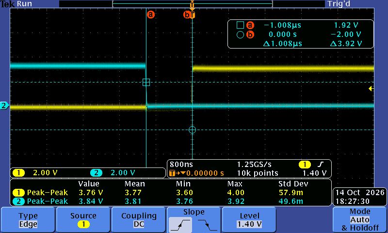

# TP AAA — Commande d'un moteur par hacheur en pont H

Compte-rendu de BOUATELI et ZEAITER. Le plan suit les questions de
l'[énoncé du TP](<TP/Sujet Travaux pratiques _ MOODLE ENSEA.pdf>).
Les résultats expérimentaux sont distingués des calculs et des travaux
restant à réaliser.

## 1 — Objectifs et matériel

Le projet utilise une Nucleo-STM32G474RE et un hacheur pour commander une
machine à courant continu (MCC). Les objectifs sont la génération des
quatre commandes de transistors, l'acquisition des capteurs, puis
l'asservissement en temps réel.

La commande en boucle ouverte et une première acquisition des courants en
polling sont disponibles. L'acquisition Timer/ADC/DMA et la mesure de
vitesse restent à réaliser avant l'asservissement.

## 2 — Bonnes pratiques retenues

Le code applicatif est séparé par domaine : commande moteur, acquisition
et interface utilisateur. Les conventions retenues sont des noms
explicites en minuscules avec underscores, des constantes nommées en
majuscules, la factorisation des traitements communs et la vérification
des retours d'erreur. Les fichiers générés par CubeMX et le code applicatif
sont conservés dans leurs emplacements respectifs.

## 3 — Dépôt GitHub et livrables

Le dépôt du binôme est
[2526_ESE_AAA_BOUATELI_ZEAITER](https://github.com/ziyehia/2526_ESE_AAA_BOUATELI_ZEAITER).
Il contient le projet STM32CubeIDE, la documentation matérielle et ce
compte-rendu, destiné à être complété au fil des séances.

## 4 — Organisation du projet

| Emplacement | Rôle |
| --- | --- |
| `TP/software/Base/` | Projet STM32CubeIDE et configuration CubeMX de la Nucleo. |
| `Core/Src/app.c` | Initialisation et orchestration de l'application. |
| `Core/Src/motor_control/` | Commande du pont H et progression des consignes. |
| `Core/Src/acquisition/` | Mesures analogiques ; emplacement prévu pour l'acquisition du codeur. |
| `Core/Src/user_interface/` | Shell, LED et bouton. |
| `TP/hardware/Inverter_KiCAD/` | Schémas et routage de la carte. |
| `TD/` | Projets d'exercices distincts du projet de TP. |

Les chemins commençant par `Core/` sont relatifs à `TP/software/Base/`.
La réception UART est prise en charge par interruption ; le traitement des
commandes et la rampe moteur sont exécutés dans la boucle principale.
La mesure de courant en polling utilise une attente bornée.

## 5 — Shell

Le terminal communique avec la Nucleo par la liaison série USB à
**115200 bauds, 8 bits de données, sans parité et avec 1 bit de stop**.
Les commandes sont validées par Entrée et `help` affiche leur liste.
La commande `current` réalise une acquisition ponctuelle du courant du bus
et de celui du bras U ; ses résultats sont présentés en partie 7.2.

### 5.1 — Saisie et correction

Le shell accepte les lettres non accentuées (`a` à `z`, `A` à `Z`), les
chiffres, les espaces, `_` et `=`. Ces caractères sont affichés pendant la
saisie. Backspace permet d'effacer un caractère tant que la ligne reste
valide. Les fins de ligne CR, LF et CRLF sont reconnues.

Les caractères supplémentaires, notamment `-`, `+`, `.` et les caractères
accentués comme `ç`, sont refusés. Un caractère refusé n'est pas affiché et
invalide toute la ligne. Le shell ignore alors les caractères suivants,
y compris Backspace, jusqu'à Entrée. Ce comportement peut donner
l'impression que la saisie est bloquée ; Entrée affiche l'erreur et rend
le prompt disponible pour une nouvelle commande.

Le tampon autorise **63 caractères utiles** : la dernière place est réservée
à la fin de chaîne. Une ligne trop longue est également rejetée entièrement.

## 6 — Commande MCC basique

Le moteur est raccordé entre les points milieux des bras U et V. Chaque
bras comporte un transistor haut et un transistor bas commandés en
complémentaire, avec un temps mort entre leurs activations.


*Schéma fourni : alimentation indiquée à 50 V / 5 A et moteur indiqué à
48 V / 12 A. Les drivers de grille ne sont pas représentés sur ce dessin
de principe.*

### 6.1 — Génération des quatre PWM

#### Affectation des sorties et cahier des charges

| Commande | Broche Nucleo | Sortie du timer |
| --- | --- | --- |
| `U_PWM_H` | PA8 | TIM1_CH1 |
| `U_PWM_L` | PB13 | TIM1_CH1N |
| `V_PWM_H` | PA9 | TIM1_CH2 |
| `V_PWM_L` | PB14 | TIM1_CH2N |

Le bras W n'est pas utilisé pour ce moteur. La configuration réalisée
utilise deux paires complémentaires de TIM1, en PWM centrée, avec des
rapports cycliques complémentaires entre U et V.

| Grandeur | Exigence de l'énoncé | Configuration retenue |
| --- | --- | --- |
| Fréquence PWM | 20 kHz | 20 kHz calculés |
| Résolution | Au moins 10 bits | Environ 12 bits |
| Temps mort | À dimensionner et faire valider | 1 µs programmé, validation de puissance à compléter |
| Point de test | 60 % | CCR1 = 2550 et CCR2 = 1700 |

La conformité des quatre chronogrammes à la commande complémentaire
décalée demandée doit être vérifiée sur le montage avec l'enseignant.

#### Horloge, période et résolution

L'horloge configurée est issue du quartz de 24 MHz et de la PLL :

$$
f_{TIM1} = \frac{24\,\mathrm{MHz}}{6}\times\frac{85}{2}
= 170\,\mathrm{MHz}
$$

Le compteur est en mode center-aligned, avec un prescaler de 0. Un cycle
complet correspond à une montée puis une descente du compteur :

$$
f_{PWM} = \frac{f_{TIM1}}{2(PSC+1)ARR}
= \frac{170\times10^6}{2\times4250}
= 20\,\mathrm{kHz}
$$

La période est donc de 50 µs. Le réglage de comparaison offre environ
4250 pas sur la plage de rapport cyclique, soit :

$$
R \simeq \log_2(4250) \simeq 12{,}05\,\mathrm{bits}
$$

La résolution minimale de 10 bits est ainsi dépassée. Pour le point de
test à 60 %, CCR1 vaut 0,6 × 4250 = 2550 et CCR2 vaut 1700. Les rapports
cycliques nominaux sont de 60 % sur U et 40 % sur V, avant l'effet du temps mort.

#### Temps mort et vérification des signaux

Les transistors du schéma KiCad sont des IRF540N, commandés par des
HCPL-315J avec des résistances de grille de 30 Ω.
La [datasheet IRF540N](https://www.infineon.com/assets/row/public/documents/24/49/infineon-irf540n-datasheet-en.pdf)
donne des délais typiques de 11 ns à l'allumage, 39 ns à l'extinction et
35 ns de temps de descente, pour une résistance de grille de 5,1 Ω et une
commande de grille de 10 V. Le
[HCPL-315J](https://docs.broadcom.com/doc/AV02-0164EN)
spécifie un écart de propagation entre commandes pouvant atteindre 350 ns
dans ses conditions de caractérisation.

Ces valeurs ne permettent pas de garantir directement un temps mort
minimal pour notre carte : les délais du MOSFET sont typiques et les
conditions de commande diffèrent. **Un temps mort initial de 1 µs a été
retenu ; sa suffisance pour les commutations réelles reste à valider.**

Avec une division d'horloge de 1, le pas de base vaut 1 / 170 MHz. Le code
de temps mort DTG = 149 = 0x95 donne :

$$
t_{mort} = (64+21)\times2\times\frac{1}{170\times10^6}
= 1\,\mu\mathrm{s}
$$



*La capture disponible affiche un écart entre fronts de 1,008 µs, proche
du réglage de 1 µs. L'identification des voies et des bras observés reste
à consigner ; cette capture ne caractérise pas à elle seule l'extinction
réelle des MOSFET ni l'ensemble des quatre signaux.*

### 6.2 — Commande du rapport cyclique par UART

La commande `SET_CCR XXXX` est reconnue par son nom exact. Son argument
est converti en entier décimal après vérification qu'il contient uniquement
des chiffres de `0` à `9`. La plage autorisée est **0 à 4250 inclus** :
`PWM_MAX = ARR = 4250`. La valeur X correspond à un rapport cyclique
X / PWM_MAX sur le bras U.

Après validation, la valeur X est appliquée aux deux canaux :

- `CCR1 = X` pour le bras U ;
- `CCR2 = ARR − X` pour le bras V.

Les sorties complémentaires CH1N et CH2N suivent les canaux principaux avec
le temps mort configuré dans TIM1. Ces commandes agissent sur le rapport
cyclique ; elles ne constituent pas à elles seules un asservissement de
vitesse.

Par exemple, `SET_CCR 2550` applique CCR1 = 2550 et CCR2 = 1700. Le shell
confirme les valeurs par le message :

```bash
CCR1=2550 CCR2=1700 MAX=4250
```

L'énoncé propose de ramener une valeur excessive au maximum autorisé.
Le choix d'interface retenu dans ce projet est de **refuser une valeur hors
plage avec un message d'erreur**, sans remplacer la consigne précédente.
Ce comportement constitue un écart explicite par rapport à la saturation
proposée dans l'énoncé.

#### Validation et messages d'erreur

Une commande rejetée **ne modifie pas la consigne en cours**. Si une rampe
est déjà active, elle continue vers sa cible précédente. Les valeurs
supérieures au maximum ne sont pas ramenées à la borne : elles sont refusées.

| Saisie suivie d'Entrée | Réponse du shell |
| --- | --- |
| `SET_CCR 4251` ou `speed 9999` | `Error: value out of range. CCR range: 0-4250.` |
| `SET_CCR 12a3` ou `speed abc` | `Error: enter digits only. CCR range: 0-4250.` |
| `SET_CCR` sans argument | `Error: enter one digits-only value. CCR range: 0-4250.` |
| `SET_CCR 100 200` | `Error: enter one digits-only value. CCR range: 0-4250.` |
| `SET_CCR -100` ou présence d'un caractère refusé | `Invalid or too long command` |
| Ligne dépassant 63 caractères | `Invalid or too long command` |
| `speed 2975` lorsque les PWM sont désactivées | `Error: PWM stopped. Use start first.` |
| `start 1` | `Error: usage: start` |
| `stop 1` | `Error: usage: stop` |

Une suite de chiffres dépassant la capacité du type entier est refusée avec
le message de dépassement de plage, si la ligne respecte la limite du tampon.

Avec cette loi de commande, **X = 0 n'est pas une commande d'arrêt** : les
rapports cycliques des bras valent idéalement 0 % et 100 %. Pour X = 2125,
les deux bras ont le même rapport cyclique et la tension moyenne idéale
entre U et V est nulle ; cela ne garantit pas l'arrêt mécanique du moteur.
La commande `stop` désactive les PWM ; elle ne garantit pas non plus un
arrêt mécanique instantané.

### 6.3 — Premiers tests

#### Consignes et tension moyenne appliquée

Avec la modulation retenue, le rapport cyclique indiqué est celui du bras U.
Celui du bras V est complémentaire : pour une consigne de 70 % sur U, il vaut
30 % sur V. Avec ARR = 4250, les valeurs correspondantes sont :

| Point de fonctionnement | CCR1 | CCR2 | Rapport cyclique U | Rapport cyclique V | Tension moyenne idéale entre U et V |
| --- | --- | --- | --- | --- | --- |
| Consigne de 50 % | 2125 | 2125 | 50 % | 50 % | 0 |
| Premier démarrage observé | 2400 | 1850 | 56,47 % | 43,53 % | 0,1294 × Vbus |
| Consigne de 70 % | 2975 | 1275 | 70 % | 30 % | 0,4 × Vbus |

Ces tensions sont calculées à partir du modèle idéal du pont, sans tenir
compte des temps morts ni des chutes de tension des composants :

$$
\overline{V_{UV}} = (D_U - D_V)\,V_{bus}
= \left(\frac{2\,CCR1}{4250}-1\right)V_{bus}
$$

Les valeurs à 70 % décrivent la consigne calculée ; aucun relevé de vitesse
ou de courant n'est rapporté ici pour ce point. Le schéma de principe
indique 50 V / 5 A pour l'alimentation et 48 V / 12 A pour le moteur. La tension réelle du bus pendant les essais,
les conditions de charge et la validation des signaux par le professeur
restent à consigner ; les indications du dessin ne remplacent pas une
mesure ni la vérification des données constructeur.

#### Observations et interprétation du démarrage

À 50 % sur les deux bras, le moteur ne tourne pas. Ce résultat est cohérent
avec une tension moyenne idéale nulle à ses bornes.

En augmentant progressivement CCR1 par pas de 100 lors de l'essai manuel,
le premier démarrage a été observé pour **CCR1 = 2400**. Cette valeur
correspond à CCR2 = 1850 et à une tension moyenne idéale d'environ
12,94 % de la tension du bus.

Ce seuil de démarrage est compatible avec la nécessité de produire un
couple suffisant pour vaincre les frottements statiques et la charge
mécanique. CCR1 = 2400 est le premier point de démarrage observé avec le pas
d'essai utilisé ; il ne représente pas une mesure précise du seuil minimal.

#### Problème lié aux changements brusques de consigne

Une augmentation brusque du rapport cyclique du bras U, accompagnée de la
diminution de celui du bras V, augmente rapidement la tension moyenne
appliquée au moteur. La vitesse et la force contre-électromotrice ne
pouvant pas augmenter instantanément, cette variation peut entraîner un
appel de courant important. L'inductance du moteur
limite la vitesse de variation du courant : celui-ci ne change pas
instantanément.

**Les pics de courant n'ont pas été mesurés pendant cet essai.**

La rampe automatique ajoutée pour atténuer les changements brusques de
consigne est décrite en partie 7.1.

## 7 — Commande en boucle ouverte et acquisition des mesures

### 7.1 — Commande de la vitesse avec accélération limitée

Au démarrage du programme, **les quatre sorties PWM restent désactivées**.
Les commandes disponibles sont :

| Commande | Comportement |
| --- | --- |
| `start` | Fixe les deux bras à 50 % et active les quatre sorties PWM. |
| `stop` | Désactive les quatre sorties PWM et annule la rampe en cours. |
| `speed XXXX` | Rejoint progressivement la cible entre 0 et 4250 sur 3 secondes. Les PWM doivent avoir été activées par `start`. |
| `SET_CCR XXXX` | Réglage direct, sans rampe ; annule une rampe en cours et n'active pas les PWM. |

Le terme `speed` désigne ici une consigne de rapport cyclique, et non une
vitesse mesurée ou une régulation en boucle fermée.

#### Utilisation des commandes

Pour rejoindre progressivement une consigne de 70 % sur le bras U, puis
désactiver les PWM, la séquence de commandes est :

```bash
start
speed 2975
stop
```

La commande `stop` peut être envoyée pendant la rampe : elle l'annule sans
attendre son terme. Une nouvelle commande `speed` pendant une rampe repart
de la valeur déjà atteinte vers la nouvelle cible, sur une nouvelle durée
de 3 secondes. La progression s'applique aux augmentations comme aux
diminutions de consigne. Le shell reste disponible pendant cette évolution.

Une nouvelle commande `start` rétablit les deux bras à 50 % et annule toute
rampe précédente. Si la cible demandée est déjà atteinte, aucune progression
n'est nécessaire. Après `stop`, une commande `speed` est refusée jusqu'au
prochain `start`.

#### Progression du rapport cyclique

Pour atténuer les appels de courant liés aux changements brusques, une
rampe automatique a été ajoutée à la commande `speed`. La valeur appliquée
évolue progressivement de la valeur actuelle vers la cible sur **3 secondes**,
avec une mise à jour toutes les **10 ms**. La cible finale est atteinte sans
dépassement et les deux bras conservent la relation CCR2 = ARR − CCR1.

Par exemple, après `start`, la commande `speed 2975` fait évoluer CCR1 de
2125 vers 2975, tandis que CCR2 passe de 2125 à 1275. Sur les 300 intervalles
de la rampe, cela représente une variation moyenne d'environ 2,83 pas de
CCR par intervalle, au lieu d'un saut unique de 850 pas. Cette progression
ne bloque pas la réception des commandes, notamment `stop`.

Les incréments manuels utilisés lors du premier essai pour rechercher le
seuil de démarrage sont distincts de cette rampe automatique. `SET_CCR`
reste une commande de réglage direct : il faut utiliser `speed` pour
bénéficier de la progression.

### 7.2 — Mesure de courant

#### Courants à mesurer et capteurs retenus

Le courant d'induit du moteur est mesuré sur la sortie du bras U. Le
courant du bus est mesuré séparément pour observer les échanges avec
l'alimentation. Le courant moteur peut continuer à circuler pendant une
phase de recirculation, alors que le courant prélevé sur le bus est faible
ou nul : les deux mesures ne sont donc pas interchangeables.

Les capteurs de courant identifiés dans les schémas KiCad sont des
**LEM GO 10-SME/SP3**, alimentés en 3,3 V :

| Courant | Capteur | Signal | Mesure dans cette étape |
| --- | --- | --- | --- |
| Sortie du bras U, courant moteur | U204 | `U_Imes` | Acquis |
| Sortie du bras V | U304 | `V_Imes` | Non acquis ; idéalement opposé au courant U pour le moteur entre U et V |
| Sortie du bras W | U404 | `W_Imes` | Bras non utilisé |
| Bus continu alimentant le pont | U601 | `Bus_Imes` | Acquis |

#### Fonctions de transfert courant-tension

La [datasheet du GO 10-SME/SP3, page 4](https://www.lem.com/sites/default/files/products_datasheets/go_10-20-sme_sp3_series.pdf)
indique une sensibilité nominale de **50 mV/A**, une référence interne
nominale de **1,65 V**, un courant nominal efficace de **10 A** et une
plage de mesure de **−25 à +25 A**. Pour un courant positif allant de IP+
vers IP−, la relation nominale, avec V en volts et I en ampères, est :

$$
V_{sortie} = 1{,}65 + 0{,}050\,I
\qquad\Longleftrightarrow\qquad
I = \frac{V_{sortie}-1{,}65}{0{,}050}
$$

Le même modèle s'applique aux capteurs du bus et du bras U. Il s'agit de la
caractéristique statique nominale ; l'offset propre à chaque capteur reste
à mesurer à courant réellement nul.

#### Broches utilisées et configuration en polling

| Ordre de conversion | Signal | Broche de la Nucleo configurée | Canal |
| --- | --- | --- | --- |
| Rang 1 | `Bus_Imes` | PC2 | ADC1_IN8 |
| Rang 2 | `U_Imes` | PA1 | ADC1_IN2 |

Ce tableau décrit la configuration du projet Nucleo. Le schéma comporte
aussi un STM32 U801 dont certaines affectations diffèrent : le raccordement
réel de la carte à la Nucleo doit être suivi par les connecteurs, sans
confondre les deux configurations.

ADC1 est réglé sur 12 bits, avec un déclenchement logiciel, un temps
d'échantillonnage de **2,5 cycles** et deux conversions successives.
Auto Wait est activé pour conserver chaque résultat jusqu'à sa lecture.
Une attente maximale de **1 ms par rang** est utilisée. La calibration
interne de l'ADC est effectuée au démarrage ; elle ne remplace pas
l'étalonnage du zéro des capteurs.

Pour chaque commande `current`, les valeurs brutes N sont converties avec
une référence ADC supposée à 3,3 V :

$$
V_{mesuré} \simeq \frac{N}{4095}\times3{,}3
$$

Le courant est ensuite estimé avec le modèle nominal du capteur. Le champ
`I_est`, exprimé en mA, signale que les paramètres réels de référence et
d'offset n'ont pas encore été mesurés. Les deux courants sont prélevés
successivement et sans synchronisation avec la PWM.

#### Premiers relevés après désactivation des PWM

La commande `stop` a d'abord été envoyée, puis trois acquisitions
successives ont été demandées avec `current`.
Chaque acquisition fournit la valeur brute ADC, la tension calculée et le
courant estimé pour le bus et le bras U :

```bash
MSC@SAC-TP:/stop
PWM stopped; ramp cancelled.
MSC@SAC-TP:/current
Bus: ADC=2058 V=1658 mV I_est=169 mA
U: ADC=2063 V=1662 mV I_est=249 mA
MSC@SAC-TP:/current
Bus: ADC=2053 V=1654 mV I_est=88 mA
U: ADC=2048 V=1650 mV I_est=8 mA
MSC@SAC-TP:/current
Bus: ADC=2060 V=1660 mV I_est=201 mA
U: ADC=2056 V=1657 mV I_est=136 mA
```

Les tensions calculées sont proches de 1,65 V, valeur nominale de sortie
des capteurs à courant nul. Les courants restent des estimations utilisant
les paramètres nominaux indiqués ci-dessus ; le zéro réel de chaque capteur
n'a pas encore été étalonné.

Sur ces trois acquisitions, le courant estimé varie de 88 à 201 mA pour
le bus et de 8 à 249 mA pour le bras U. Ces écarts peuvent inclure un
décalage du zéro et des fluctuations de mesure. Ils ne permettent pas, à
eux seuls, de conclure à un courant résiduel réel : la commande `stop`
désactive les PWM, mais ne confirme pas l'immobilité du moteur ni un courant
effectivement nul au moment des relevés.

#### Relevés après activation et consigne `speed 3000`

La commande `start` a activé les PWM à 50 %, puis `speed 3000` a demandé
une progression vers CCR1 = 3000 sur 3 secondes.

La cible correspond à CCR2 = 1250, soit des rapports cycliques d'environ
70,59 % pour U et 29,41 % pour V. Le délai entre la commande et les lectures
n'ayant pas été relevé, ces acquisitions ne sont pas considérées comme des
mesures garanties en régime stabilisé.

```bash
MSC@SAC-TP:/start
PWM started: CCR1=2125 CCR2=2125.
MSC@SAC-TP:/speed 3000
Speed target CCR1=3000; ramp=3000 ms.
MSC@SAC-TP:/current
Bus: ADC=2177 V=1754 mV I_est=2087 mA
U: ADC=2227 V=1795 mV I_est=2893 mA
MSC@SAC-TP:/current
Bus: ADC=2061 V=1661 mV I_est=217 mA
U: ADC=2173 V=1751 mV I_est=2022 mA
MSC@SAC-TP:/current
Bus: ADC=1997 V=1609 mV I_est=-813 mA
U: ADC=2217 V=1787 mV I_est=2731 mA
```

Sur ces trois lectures, le courant estimé du bras U est supérieur à celui
des premiers relevés après `stop`. Le courant estimé du bus présente une
dispersion importante, de -813 à 2087 mA. Les acquisitions en polling ne
sont pas synchronisées avec la PWM et les deux courants sont lus
successivement. Le découpage et les phases de recirculation peuvent donc
contribuer aux différences observées, en plus des erreurs de mesure et
des éventuels transitoires du moteur.

La valeur négative ponctuelle du courant du bus ne suffit pas à démontrer
un fonctionnement en récupération d'énergie. Les offsets des capteurs et
la qualité de la chaîne de mesure restent à vérifier avant une
interprétation quantitative de ces courants.

#### Essais demandés et limites des résultats

| Essai demandé dans l'énoncé | Éléments disponibles | Complément nécessaire |
| --- | --- | --- |
| Vitesse nulle | Immobilité observée à 50 % en partie 6.3 ; relevés de courant après `stop` ci-dessus. | Relever aussi les courants à 50 % avec les PWM actives ; confirmer les conditions de courant nul. |
| Vitesse non nulle | Relevés après `start` et `speed 3000`. | Consigner le délai après la rampe et les conditions de charge. |
| Essai en charge avec la machine synchrone couplée | Aucun relevé en charge identifié dans les résultats disponibles. | Ajouter la charge appliquée et les courants correspondants. |

La dispersion peut provenir de l'ondulation réelle des courants, de
l'instant de prélèvement par rapport au découpage, des transitoires et du
bruit de mesure. Un offset déplace surtout la moyenne ; il ne suffit pas
à expliquer les fluctuations entre acquisitions.

Les vérifications restantes sont la mesure du zéro propre à chaque
capteur, la vérification de la référence ADC et la comparaison des lectures
avec un temps d'échantillonnage plus long. Une lecture stable ou une
moyenne ne démontre pas à elle seule l'exactitude du courant estimé.

#### Passage à une acquisition Timer/ADC/DMA

Cette étape de l'énoncé **n'est pas encore implémentée**. Elle doit assurer
un déclenchement à intervalle régulier, le transfert des deux résultats
ADC en mémoire et leur traitement sans attente de conversion par le
programme principal.

La cadence et l'instant de prélèvement par rapport aux commutations PWM
restent à définir. Avec TIM1 en mode centré, un cycle comporte une montée
et une descente du compteur : le choix de l'événement de déclenchement doit
éviter de confondre fréquence PWM et fréquence d'acquisition.

La vérification demandée à l'oscilloscope consistera à comparer la PWM et
une impulsion sur un GPIO disponible associée à l'acquisition. Aucun
chronogramme de cette vérification n'est encore présenté.

### 7.3 — Mesure de vitesse

Cette partie reste à réaliser. Aucun résultat de mesure de vitesse par
codeur ni de constante de temps mécanique n'est présenté à ce stade.
Les réponses à compléter sont :

- Identifier le capteur de vitesse et sa résolution pour établir la
  conversion entre comptage ou fréquence et vitesse mécanique.
- Déterminer la constante de temps mécanique à partir de la réponse à un
  échelon de tension, en utilisant la sonde tachymétrique comme demandé.
- Confirmer les broches utilisées à partir du schéma du codeur et du
  raccordement réel à la Nucleo.
- Choisir la fréquence d'asservissement à partir de la dynamique mesurée.
- Mettre en place l'acquisition de vitesse et présenter ses essais.

## Documentation utilisée

- [Énoncé du TP](<TP/Sujet Travaux pratiques _ MOODLE ENSEA.pdf>).
- [Schéma KiCad du pont et des mesures](TP/hardware/Inverter_KiCAD/Inverter_KiCAD.kicad_sch).
- [Manuel de la Nucleo STM32G4 — UM2505](TP/um2505-stm32g4-nucleo64-boards-mb1367-stmicroelectronics.pdf).
- [Manuel de référence STM32G4 — RM0440](TP/rm0440-stm32g4-series-advanced-armbased-32bit-mcus-stmicroelectronics_compress.pdf).
- [Documentation HAL/LL STM32G4 — UM2570](TP/um2570-description-of-stm32g4-hal-and-lowlayer-drivers--stmicroelectronics.pdf).
- Datasheets [IRF540N](https://www.infineon.com/assets/row/public/documents/24/49/infineon-irf540n-datasheet-en.pdf),
  [HCPL-315J](https://docs.broadcom.com/doc/AV02-0164EN) et
  [GO 10-SME/SP3](https://www.lem.com/sites/default/files/products_datasheets/go_10-20-sme_sp3_series.pdf).
